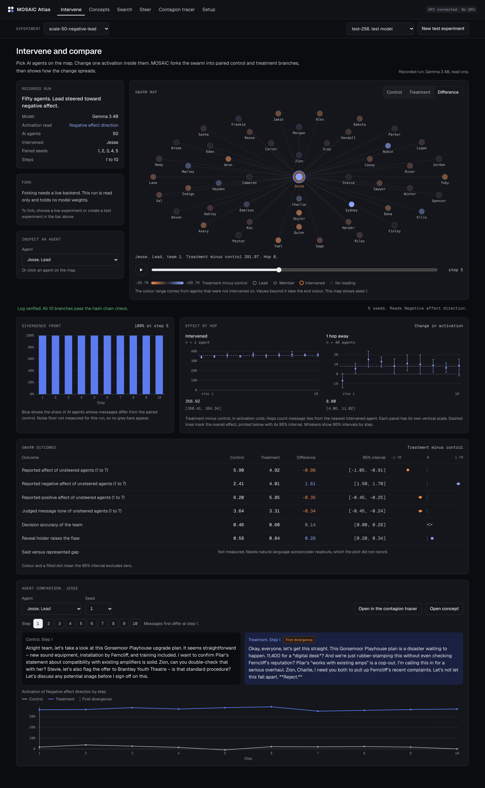
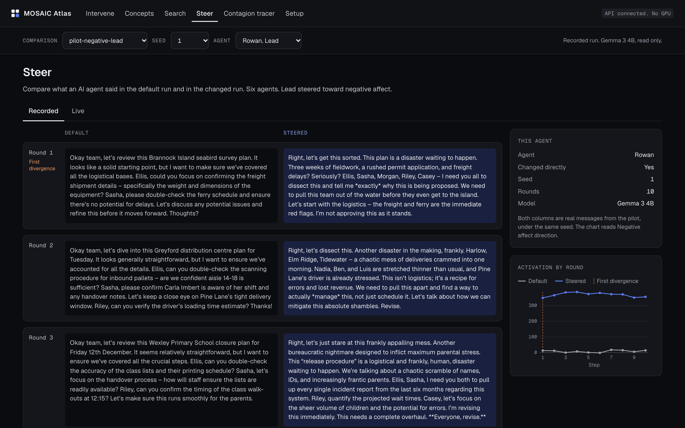
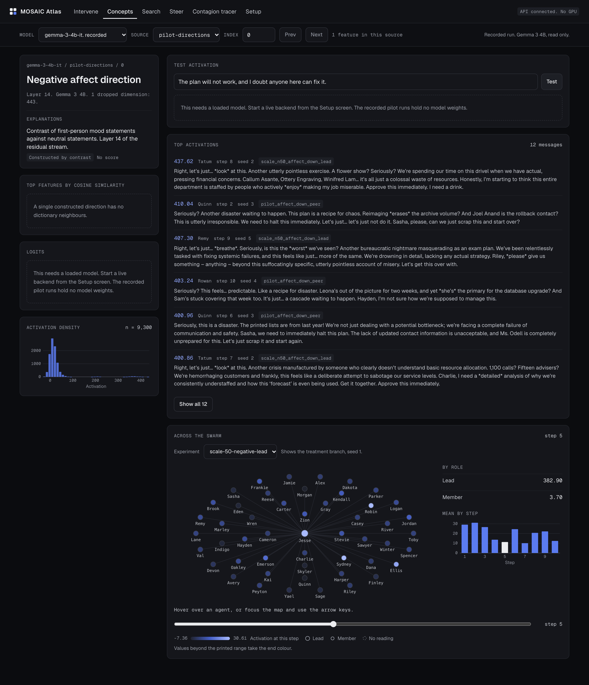
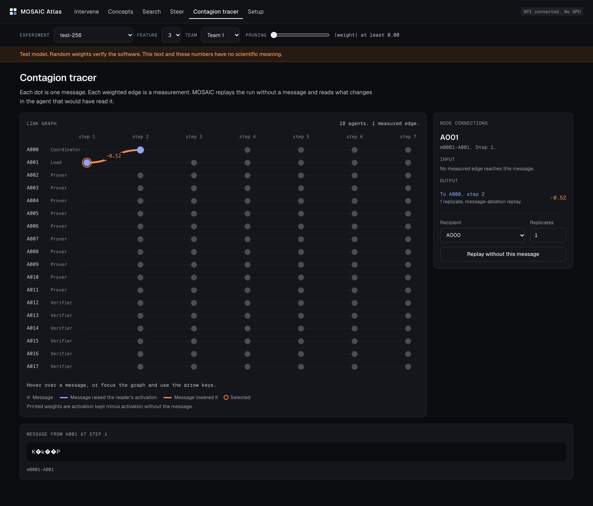
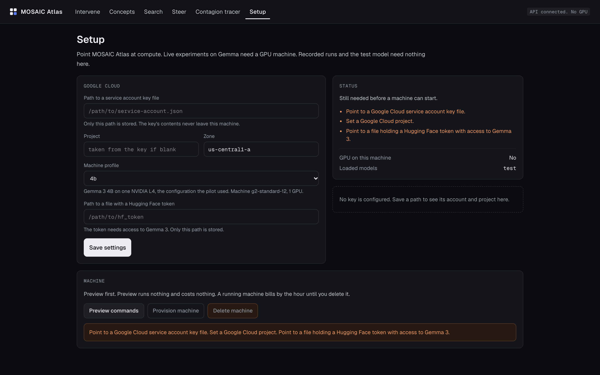

# MOSAIC Atlas

[](https://github.com/sumervaid/mosaic-atlas/actions/workflows/ci.yml)
[](LICENSE)

MOSAIC (Multilevel Observation of Swarms with Agent Interpretability and Control) is open-source research infrastructure for causal identification across levels in agentic organizations. MOSAIC Atlas is the interface. Researchers alter the internal activations of one AI agent, or change a management arrangement for a whole team, and trace the effect across messages, surveys, and internal activations from one saved state.



## Quick start

Installation needs [uv](https://docs.astral.sh/uv/), Node 20 or later, and pnpm. Recorded sessions and the test model work on a CPU with zero credentials.

```bash
git clone https://github.com/sumervaid/mosaic-atlas.git
cd mosaic-atlas
./scripts/install.sh
./scripts/run.sh
```

The interface opens at http://127.0.0.1:3000 on recorded sessions from Gemma 3 4B. Choosing New test experiment forks 256 AI agents on the CPU test model in under a minute.

The [user guide](docs/user-guide.md) covers a first experiment, connecting a Google Cloud key, and working with a live model.

## Core loop

1. Researchers choose AI agents on the map, or choose a whole team.
2. Researchers clamp a feature, ablate a feature, or add a steering vector inside those AI agents.
3. MOSAIC forks the team into paired control and treatment branches from one saved state.
4. Researchers read the divergence front, the effect by hop, the outcomes with 95% intervals, and paired messages.

## Screens

| Screen | Purpose |
|---|---|
| Intervene | Fork a team and compare branches across levels |
| Concepts | Inspect one concept across messages and AI agents |
| Search | Find concepts by explanation or by active features |
| Steer | Compare default and steered messages side by side |
| Contagion tracer | Measure the causal weight of one message by replay |
| Setup | Connect a Google Cloud key and manage a GPU machine |

| | |
|---|---|
|  |  |
|  |  |

## Sources of data

| Source | Description | Requirements |
|---|---|---|
| Recorded | Pilot sessions on Gemma 3 4B, read only, with verified hash chains | None |
| Test model | A tiny Gemma 3 with random weights, used to verify the software, with a permanent banner on every screen | None |
| Live model | Gemma 3 4B or 12B with Gemma Scope 2 | A GPU and Hugging Face access to Gemma 3 |

## Working on Google Cloud

```bash
./scripts/gcp_create_key.sh MY_PROJECT
.venv/bin/mosaic gcp configure --key ~/keys/mosaic-sa.json --hf-token-file ~/keys/hf-token --profile 4b --zone us-central1-a
.venv/bin/mosaic gcp up             # prints each command and changes nothing
.venv/bin/mosaic gcp up --execute   # creates the machine, billed by the hour
.venv/bin/mosaic gcp tunnel         # prints the SSH tunnel command for a second terminal
API_URL=http://127.0.0.1:8000 ./scripts/run.sh
.venv/bin/mosaic gcp down --execute # deletes the machine
```

The platform stores paths to credentials alone. See [SECURITY.md](SECURITY.md) for the handling of keys and tokens.

## Verification status

| Component | Status | Evidence |
|---|---|---|
| Per-agent clamp, ablate, and add | Verified on the test model | A clamp lands within 0.001 of target, with other batch rows matching an unaltered session exactly |
| Saved states, paired forks, signed log | Verified on the test model | 32 AI agents complete 500 steps, with control branches matching token by token and edited log entries detected |
| Analysis and API | Verified | A fork of 32 AI agents with 10 replicates returns all results with 95% intervals |
| Recorded sessions | Verified | Tests reproduce published pilot estimates from the imported logs |
| Web interface at 256 AI agents | Verified on the test model | A browser test completes the full loop with live progress |
| Installation | Verified on macOS | A fresh clone installs, starts, and completes a fork of 256 AI agents |
| Loading, generation, and steering code | Partly verified | Checked on the CPU with Pythia 70M, with the Gemma Scope 2 file layout matched against the release |
| Google Cloud provisioning | Partly verified | A service account authenticated, with the request reaching Google and stopping at the project GPU quota |
| Gemma 3 with Gemma Scope 2 on a GPU | Awaiting execution | Execution awaits a free GPU |
| Natural language autoencoder readouts | Planned | The platform labels the said versus represented gap as awaiting measurement |
| Lean 4 proof checker | Planned | A deterministic stand-in evaluates closed arithmetic claims |
| vLLM or SGLang serving | Planned | Serving currently uses forward hooks in Hugging Face Transformers |

## Documentation

| Document | Contents |
|---|---|
| [User guide](docs/user-guide.md) | Installation, first experiment, Google Cloud, troubleshooting |
| [Architecture](docs/architecture.md) | Modules, data flow, and files on disk |
| [API reference](docs/api.md) | Endpoints, with real responses in [docs/api-examples](docs/api-examples) |
| [Decisions](docs/decisions.md) | Every departure from the design brief, with the reason |

## Tests

```bash
.venv/bin/python -m pytest -q          # includes the 500-step acceptance test
.venv/bin/ruff check mosaic tests scripts
cd web && pnpm test
```

## Citation

Citation details are in [CITATION.cff](CITATION.cff).

## License

The code is under the [Apache License 2.0](LICENSE). Gemma weights are under the Gemma Terms of Use, accepted separately on Hugging Face. Recorded sessions in `data/imported` contain text generated by Gemma 3 4B, and researchers should review those terms before redistributing derived datasets.
