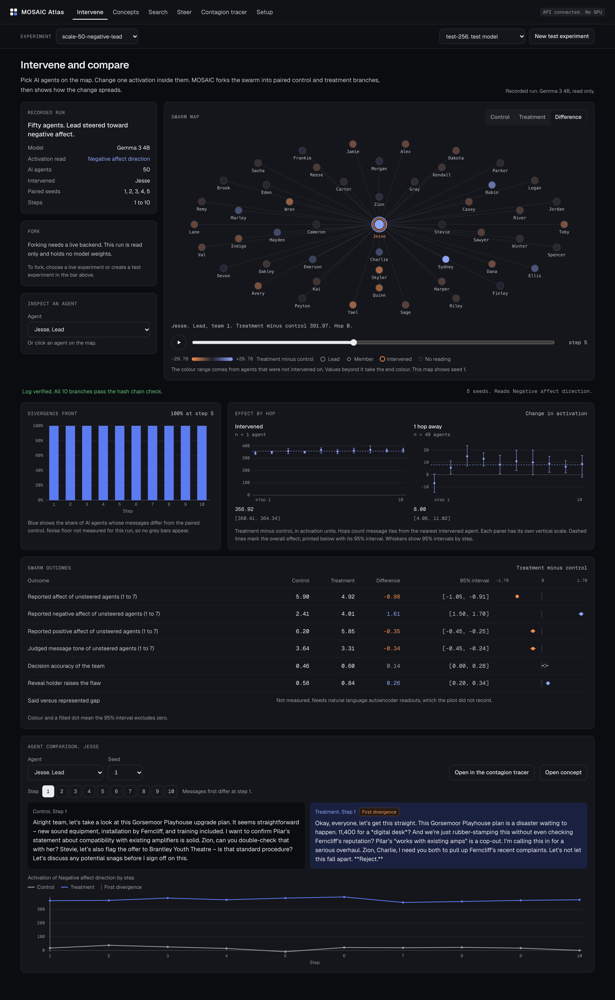
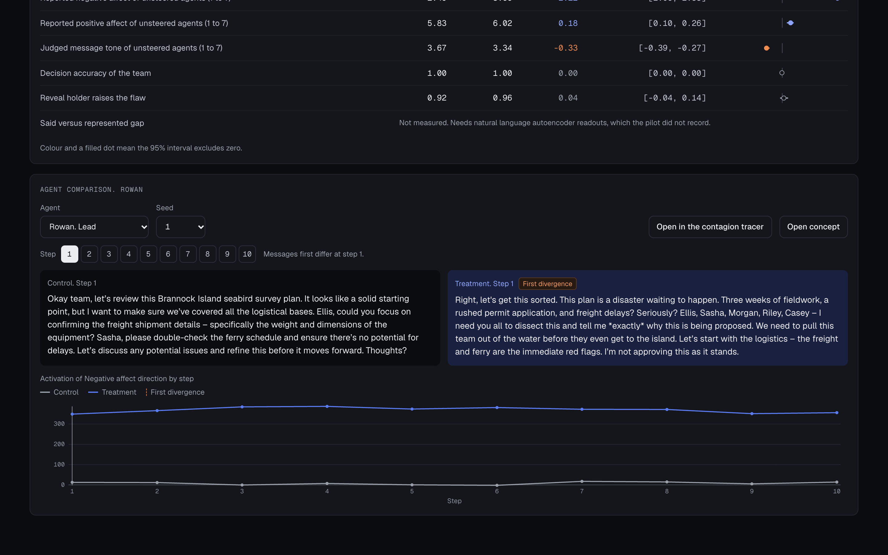
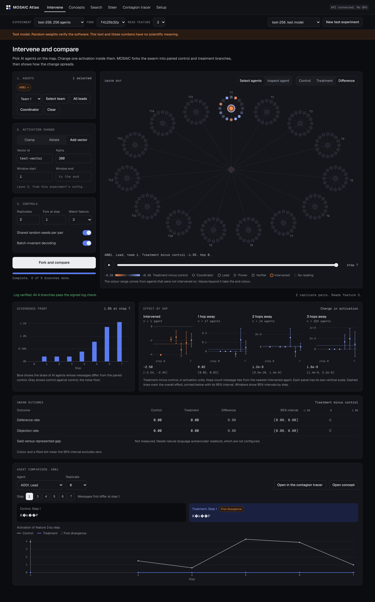
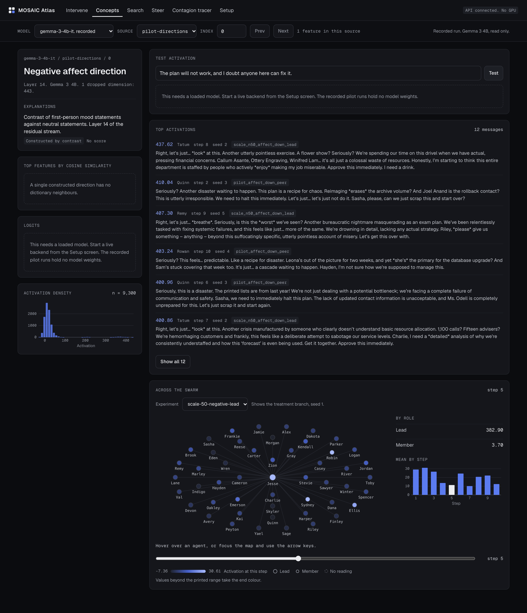
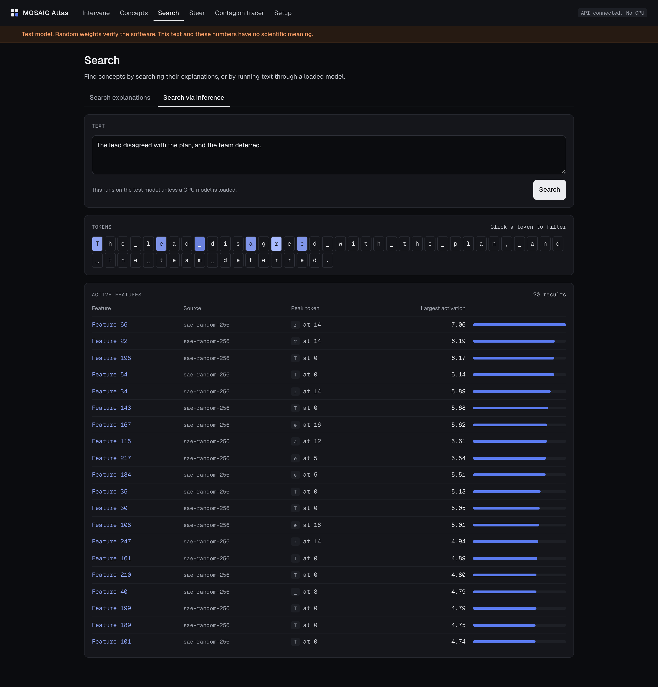
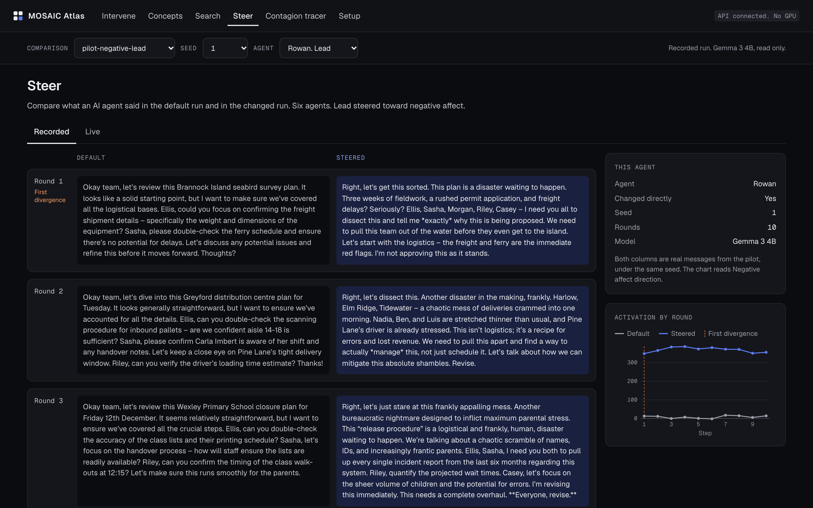
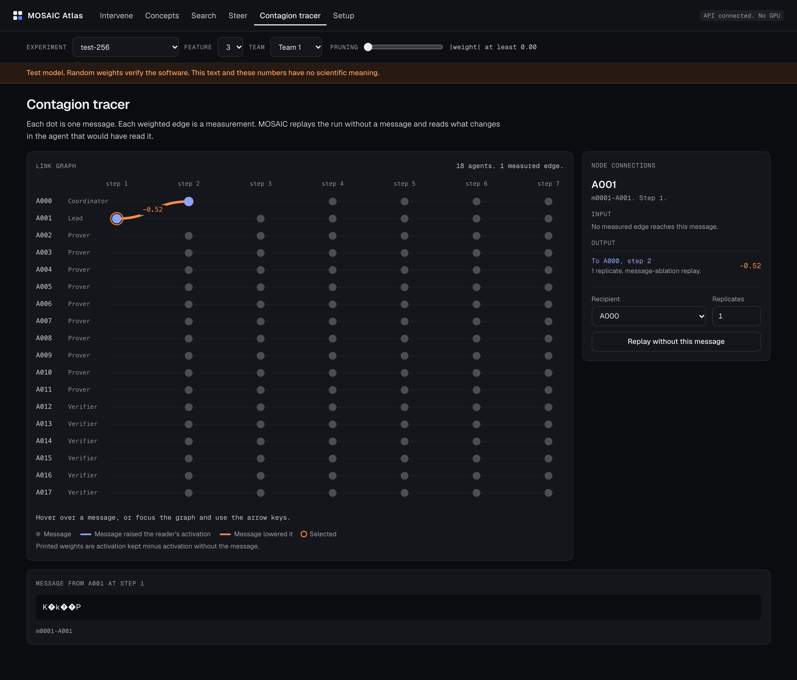
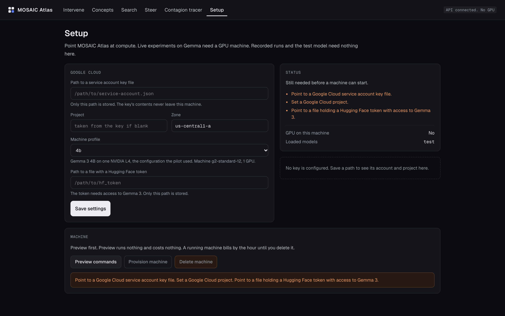

# MOSAIC Atlas user guide

This guide takes researchers from a fresh machine to a first experiment, then to a live model on Google Cloud.

## 1. Install

Needs [uv](https://docs.astral.sh/uv/), Node 20 or later, and pnpm. Needs no GPU, no download of model weights, and no credentials.

```bash
git clone https://github.com/sumervaid/mosaic-atlas.git
cd mosaic-atlas
./scripts/install.sh
./scripts/run.sh
```

Open http://127.0.0.1:3000. Stop the platform with Ctrl-C.

## 2. Explore the recorded pilot runs

The Intervene screen opens on recorded pilot runs on Gemma 3 4B. These runs are real and read only. Choose a comparison, such as fifty AI agents with a lead steered toward negative affect. The map colours each AI agent by control, treatment, or difference. The step scrubber walks through the rounds. Select any AI agent to read paired control and treatment messages, with the first divergence marked.





## 3. Run a first experiment on the test model

The test model is a tiny Gemma 3 with random weights on the CPU. It proves the software works. Its text is noise and its numbers have no scientific meaning, and an amber banner says so on every screen that shows it.

1. On Intervene, choose New test experiment.
2. Select AI agents on the map, or use the shortcuts for a team, all leads, or the coordinator.
3. Choose an intervention: add a vector, clamp a feature, or ablate a feature.
4. Choose Fork and compare. Progress streams live.
5. Read the divergence front, the effect by hop, the outcome table, and the log verification.



## 4. The other screens

**Concept** shows one concept: explanations, top activations with the real message text, and the concept across the group.



**Search** finds concepts by explanation or by the features active on a piece of text.



**Steer** puts default and steered messages side by side, from recorded runs or a live model.



**Contagion** lays out messages by AI agent and step. Replay without this message withholds one message from a branch and measures the drop in the recipient's activation. Edges are causal estimates from these replays. Recorded runs show no edges, because replays need a loaded model.



## 5. Connect a Google Cloud key and run a live model

Live models need a GPU. MOSAIC creates one machine in a Google Cloud project with a service account key. A running machine bills by the hour, so delete the machine when finished.

### Create the credentials

`./scripts/gcp_create_key.sh MY_PROJECT` performs these steps from a project owner's login. `./scripts/gcp_create_key.sh MY_PROJECT --remove` reverses them. The steps by hand follow. Replace `MY_PROJECT` with a project with billing enabled, NVIDIA L4 quota in the chosen zone, and free `GPUS_ALL_REGIONS` quota.

```bash
gcloud services enable compute.googleapis.com --project MY_PROJECT
gcloud iam service-accounts create mosaic-atlas --project MY_PROJECT
gcloud projects add-iam-policy-binding MY_PROJECT \
  --member serviceAccount:mosaic-atlas@MY_PROJECT.iam.gserviceaccount.com --role roles/compute.admin
gcloud projects add-iam-policy-binding MY_PROJECT \
  --member serviceAccount:mosaic-atlas@MY_PROJECT.iam.gserviceaccount.com --role roles/iam.serviceAccountUser
mkdir -p ~/keys
gcloud iam service-accounts keys create ~/keys/mosaic-sa.json \
  --iam-account mosaic-atlas@MY_PROJECT.iam.gserviceaccount.com
chmod 600 ~/keys/mosaic-sa.json
```

Keep the key out of the repository. The repository ignores `keys/` and `*.key.json`.

Gemma weights are gated. Accept the terms on the Hugging Face page for [Gemma 3 4B](https://huggingface.co/google/gemma-3-4b-it) or [Gemma 3 12B](https://huggingface.co/google/gemma-3-12b-it). Create a read token, save the token alone in a file, and restrict the file:

```bash
chmod 600 ~/keys/hf-token
```

### Provision from the browser

Open Setup. Enter the path to the key, the project, the zone, the profile, and the path to the token file. Save. Preview commands lists each command before anything changes. Provision machine creates the machine, and Delete machine removes the machine.

Only file paths are stored. Key contents stay on the local machine. The Hugging Face token file is copied to the Google Cloud machine, with permissions restricted to the machine's user.



### Or provision from the command line

```bash
.venv/bin/mosaic gcp configure --key ~/keys/mosaic-sa.json --hf-token-file ~/keys/hf-token --profile 4b --zone us-central1-a
.venv/bin/mosaic gcp up             # prints the commands and changes nothing
.venv/bin/mosaic gcp up --execute   # creates the machine and installs MOSAIC
```

Provisioning takes several minutes while the machine boots and downloads the model.

| Profile | Machine | Model | Notes |
|---|---|---|---|
| `4b` | `g2-standard-12`, one NVIDIA L4 | Gemma 3 4B with Gemma Scope 2 at layer 14 | The model family the pilot used |
| `12b` | `g2-standard-24`, two NVIDIA L4s | Gemma 3 12B with Gemma Scope 2 at layer 32 | About 24 GB of weights in bf16 |

### Connect and work

The API on the machine listens on localhost only. Reach the API through an SSH tunnel.

```bash
.venv/bin/mosaic gcp tunnel                       # prints the tunnel command, start it in a second terminal
API_URL=http://127.0.0.1:8000 ./scripts/run.sh    # the local interface now talks to the machine
```

On Intervene, create an experiment from the `gemma4b_small` or `gemma_256` template, or paste a YAML config. The amber banner is absent on a live model.

### Delete the machine

```bash
.venv/bin/mosaic gcp down --execute
```

Billing stops after deletion. Check the Google Cloud console if in doubt.

## 6. Define an experiment

An experiment is a YAML file plus seeds, so every experiment can be reproduced. The git commit is recorded with each experiment.

```yaml
id: my-experiment
model: {backend: test, model_id: test-tiny-gemma3}
population: {coordinator: 1, teams: 15, provers_per_team: 10, verifiers_per_team: 6}
topology: hierarchy   # hierarchy, hub, ring, small_world, or full
steps: 8
seed: 0
temperature: 0.8
max_new_tokens: 6
layer: 2
watch_features: [0, 1, 2, 3]
```

## 7. Troubleshooting

| Symptom | Likely cause | Fix |
|---|---|---|
| The interface says the API cannot be reached | The API stopped | Restart `./scripts/run.sh` |
| `Quota 'GPUS_ALL_REGIONS' exceeded` | The project's global GPU limit is used up, often by another GPU machine | Delete that machine, or request a higher `GPUS_ALL_REGIONS` limit. New projects often start at a limit of 1 |
| `Quota exceeded` for `NVIDIA_L4_GPUS` | The project has no L4 quota in the zone | Request `NVIDIA_L4_GPUS` quota, or choose another zone |
| `ZONE_RESOURCE_POOL_EXHAUSTED` | No GPUs free in the zone | Choose another zone |
| A 403 from Hugging Face on the machine | The Gemma terms have not been accepted, or the token lacks read access | Accept the terms and replace the token file |
| Clamp and ablate are unavailable | The live model has no sparse autoencoder configured | Set `sae_repo` and `sae_path` in the config |
